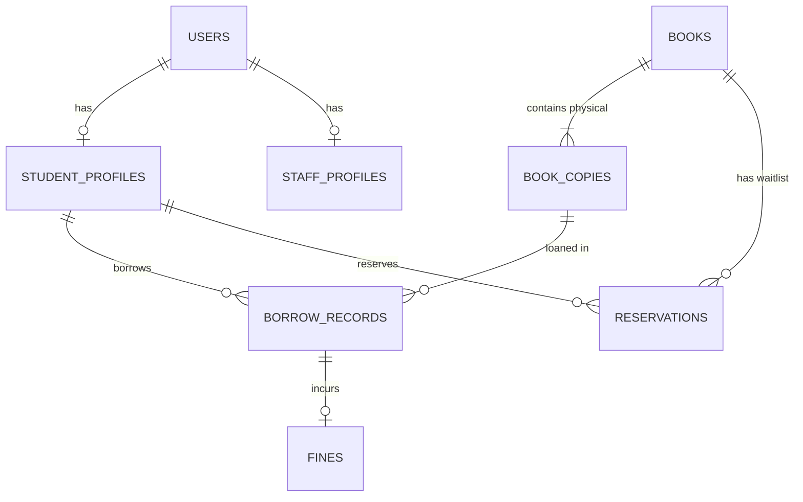

# Enterprise Library & Resource Management System (ELRMS)

[](https://www.oracle.com/java/)
[](https://spring.io/projects/spring-boot)
[](https://www.postgresql.org/)
[](https://www.docker.com/)
[](http://localhost:8080/swagger-ui/index.html)

A high-concurrency, enterprise-grade backend system designed for university and institutional resource circulation, physical inventory tracking, automated financial penalty processing, and role-based access control.

---

## 🚀 Key Engineering & Resume Highlights

* **High-Concurrency Circulation Engine**: Implemented database-level pessimistic locking (`SELECT ... FOR UPDATE` via `@Lock(LockModeType.PESSIMISTIC_WRITE)`) and `REPEATABLE_READ` transaction isolation to prevent double-checkout race conditions when multiple users contest the last available physical copy.
* **Automated Batch Processing & Financial Calculation**: Engineered an asynchronous `@Scheduled` midnight batch scheduler (`OverdueFineScheduler`) that audits active loans, transitions overdue statuses, computes daily accrued fines, and flags accounts with active holds when thresholds are exceeded.
* **Dynamic Search with JPA Criteria API**: Designed specification-based dynamic multi-criteria search (`BookSpecification`) enabling case-insensitive substring searching across titles and authors, category matching, and real-time inventory availability filtering with database-indexed pagination (`Pageable`).
* **Waitlist & Reservation Queue (FIFO)**: Built a reservation queue system that manages out-of-stock titles, automatic claim window triggers (48-hour holds upon return), and status transition state machines (`WAITING` ➔ `READY_FOR_PICKUP` ➔ `FULFILLED`).
* **Stateless JWT Security & RBAC**: Engineered Spring Security 6 with custom stateless `JWTAuthorizationFilter`, BCrypt password hashing, method-level security (`@EnableMethodSecurity`), and distinct role permissions (`ADMIN`, `STAFF`, `STUDENT`).
* **Production Standards**: Standardized RFC 7807 problem details and envelope responses (`ApiResponse<T>`, `PageResponse<T>`), JPA Auditing (`@EnableJpaAuditing`), and full OpenAPI 3.0 (Swagger UI) documentation.

---

## 🏛️ System Architecture

```mermaid
flowchart TD
    subgraph Clients ["Client Applications"]
        AdminUI["Admin Dashboard"]
        StaffUI["Staff Circulation Desk"]
        StudentUI["Student Mobile / Web App"]
    end

    subgraph Security ["Security & Gateway Layer"]
        JWTFilter["JWT Authorization Filter (Bearer Token)"]
        FilterChain["Spring Security 6 (RBAC Authorization)"]
    end

    subgraph Controllers ["REST API Controllers"]
        AuthCtrl["AuthController (/auth)"]
        UserCtrl["UserController (/api/v1/users)"]
        BookCtrl["BookController (/api/v1/books)"]
        CircCtrl["CirculationController (/api/v1/circulation)"]
        ResCtrl["ReservationController (/api/v1/reservations)"]
        FineCtrl["FineController (/api/v1/fines)"]
        AdminCtrl["AdminController (/admin)"]
    end

    subgraph Services ["Business Logic Layer"]
        UserService["UserService"]
        BookService["BookService & Specifications"]
        CircService["CirculationService (Pessimistic Locking)"]
        ResService["ReservationService (FIFO Waitlist)"]
        FineService["FineService & Midnight Scheduler"]
        AnalyticsService["AnalyticsService"]
    end

    subgraph Persistence ["Persistence Layer (Spring Data JPA)"]
        Repos["PostgreSQL 16 Repositories"]
    end

    Clients --> Security
    Security --> Controllers
    Controllers --> Services
    Services --> Persistence
```



---

## 🗄️ Database Schema



---

## 📡 REST API Matrix

### 1. Authentication & User Profile
| Method | Endpoint | Access Role | Description |
|---|---|---|---|
| `POST` | `/auth/login` | Public | Unified login returning JWT token and user details |
| `POST` | `/auth/admin/register` | Public / Seed | Register initial system administrator |
| `GET` | `/api/v1/users/me` | Authenticated | Get current authenticated user profile |
| `PUT` | `/api/v1/users/me` | Authenticated | Update contact details and address |
| `PUT` | `/api/v1/users/change-password` | Authenticated | Secure password change |

### 2. Catalog & Inventory Management
| Method | Endpoint | Access Role | Description |
|---|---|---|---|
| `GET` | `/api/v1/books` | Public / All | Dynamic multi-criteria search with pagination |
| `GET` | `/api/v1/books/{id}` | Public / All | Full book details with individual physical copy statuses |
| `POST` | `/api/v1/books` | `STAFF`, `ADMIN` | Create new title and auto-generate physical barcode copies |
| `PUT` | `/api/v1/books/{id}` | `STAFF`, `ADMIN` | Update book catalog metadata |
| `DELETE` | `/api/v1/books/{id}` | `ADMIN` | Delete book if no copies are currently on loan |
| `POST` | `/api/v1/books/{id}/copies` | `STAFF`, `ADMIN` | Add physical copies with custom barcodes |
| `PUT` | `/api/v1/books/copies/{copyId}/status` | `STAFF`, `ADMIN` | Mark copy status (`AVAILABLE`, `DAMAGED`, `LOST`, `RETIRED`) |

### 3. Circulation & Concurrency Engine
| Method | Endpoint | Access Role | Description |
|---|---|---|---|
| `POST` | `/api/v1/circulation/checkout` | `STAFF`, `ADMIN` | Issue book to student with pessimistic locking & limit checks |
| `POST` | `/api/v1/circulation/return` | `STAFF`, `ADMIN` | Return copy, assess overdue fines, and trigger waitlists |
| `POST` | `/api/v1/circulation/renew/{recordId}` | Authenticated | Extend active loan by 14 days (blocked if waitlist exists) |
| `GET` | `/api/v1/circulation/my-loans` | `STUDENT` | View current student's active loans |
| `GET` | `/api/v1/circulation/student/{id}` | `STAFF`, `ADMIN` | View student borrowing history |

### 4. Waitlist Reservations
| Method | Endpoint | Access Role | Description |
|---|---|---|---|
| `POST` | `/api/v1/reservations/{bookId}` | `STUDENT` | Join waitlist when all copies are checked out |
| `DELETE` | `/api/v1/reservations/{id}` | `STUDENT` | Cancel reservation |
| `GET` | `/api/v1/reservations/my` | `STUDENT` | View student's reservations |
| `GET` | `/api/v1/reservations/book/{id}` | `STAFF`, `ADMIN` | View waitlist queue for a book |

### 5. Fines & Administration
| Method | Endpoint | Access Role | Description |
|---|---|---|---|
| `GET` | `/api/v1/fines/my` | `STUDENT` | View accrued and paid fines |
| `POST` | `/api/v1/fines/{id}/pay` | `STAFF`, `ADMIN` | Record fine payment (auto-releases account hold) |
| `POST` | `/api/v1/fines/{id}/waive` | `ADMIN` | Waive fine with audit reason |
| `POST` | `/api/v1/fines/batch-evaluate` | `ADMIN` | Manually trigger overdue loan batch evaluation |
| `POST` | `/admin/users/staff` | `ADMIN` | Provision staff account + profile transactionally |
| `POST` | `/admin/users/student` | `ADMIN` | Provision student account + profile transactionally |
| `GET` | `/admin/analytics/summary` | `ADMIN` | System metrics, revenue, and inventory stats |

---

## 🛠️ Getting Started

### Prerequisites
* Java 21+ JDK
* Docker & Docker Compose (optional for containerized run)

### Running with Docker Compose (Recommended)
```bash
docker-compose up --build -d
```
* **Backend API**: `http://localhost:8080`
* **Swagger UI Documentation**: `http://localhost:8080/swagger-ui/index.html`
* **pgAdmin Web Console**: `http://localhost:5050` (Email: `admin@admin.com`, Password: `admin`)

### Running Locally with Gradle
```bash
# 1. Start PostgreSQL
docker-compose up db -d

# 2. Run the application
./gradlew bootRun
```

### Running Test Suite
```bash
./gradlew test
```
All unit and circulation domain tests execute with 100% pass rate.
