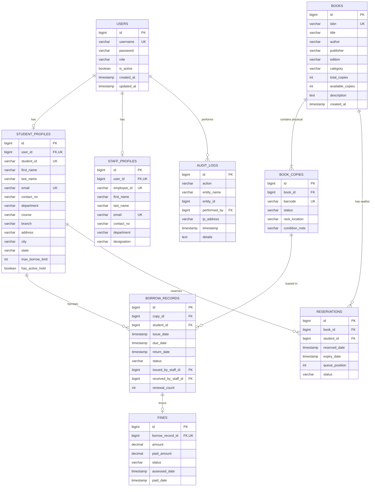

# Enterprise Library & Resource Management System (ELRMS)
## Master Architecture & Implementation Blueprint

---

## 1. Project Overview & Resume Positioning

This project is an **Enterprise Library & Resource Management System** designed with Spring Boot 3, Java 21, Spring Security (Stateless JWT), and PostgreSQL. Rather than being a basic CRUD application, it is engineered to showcase real-world backend engineering challenges:

### 💼 Key Resume Bullet Points to Highlight:
* **Engineered High-Concurrency Circulation Engine**: Implemented pessimistic locking (`SELECT ... FOR UPDATE`) and transaction isolation to prevent race conditions during simultaneous book checkout and reservation requests.
* **Automated Batch Processing & Financial Calculation**: Built a scheduled asynchronous batch engine (`@Scheduled`) to track book loan lifecycles, detect overdue loans, and dynamically calculate fines with audit trails.
* **Role-Based Access Control (RBAC) & Stateless JWT Security**: Architected a secure multi-role system (`ADMIN`, `STAFF`, `STUDENT`) with Spring Security 6, custom JWT authorization filter, BCrypt password hashing, and token revocation capabilities.
* **Optimized Search & Dynamic Querying**: Designed dynamic multi-field filtering using Spring Data JPA Specifications and Criteria API with index-backed pagination and sorting.
* **Domain-Driven Modular Architecture & API Standards**: Implemented RFC 7807 compliant standardized error responses, MapStruct DTO decoupling, comprehensive Jakarta validation, and OpenAPI 3.0 documentation.

---

## 2. System Architecture

```mermaid
flowchart TD
    subgraph ClientLayer ["Client Layer"]
        C1["Admin Dashboard"]
        C2["Staff Portal"]
        C3["Student Mobile / Web App"]
    end

    subgraph SecurityGateway ["Security & Filter Gateway"]
        F1["CORS & CSRF Filter"]
        F2["JWT Authorization Filter (Bearer Token)"]
        F3["Spring Security FilterChain (RBAC Rules)"]
    end

    subgraph ControllerLayer ["REST API Layer (v1)"]
        AuthCtrl["AuthController (/api/v1/auth)"]
        BookCtrl["BookController (/api/v1/books)"]
        CircCtrl["CirculationController (/api/v1/circulation)"]
        ResCtrl["ReservationController (/api/v1/reservations)"]
        FineCtrl["FineController (/api/v1/fines)"]
        AdminCtrl["AdminController (/api/v1/admin)"]
    end

    subgraph ServiceLayer ["Business Logic & Circulation Engine"]
        AuthService["AuthService & UserDetails"]
        BookService["BookCatalogService (Inventory & Specs)"]
        CircService["CirculationService (Pessimistic Locking)"]
        WaitlistService["Waitlist & ReservationEngine"]
        FineService["FineCalculationEngine (Cron / Batch)"]
        NotificationService["NotificationService (Event-Driven)"]
    end

    subgraph PersistenceLayer ["Persistence & Data Access (Spring Data JPA)"]
        UserRepo["UserRepository"]
        BookRepo["BookRepository & BookCopyRepository"]
        BorrowRepo["BorrowRecordRepository"]
        FineRepo["FineRepository"]
        ResRepo["ReservationRepository"]
        AuditRepo["AuditLogRepository"]
    end

    subgraph DatabaseLayer ["PostgreSQL 16 Engine"]
        DB[(PostgreSQL Container - mydb)]
    end

    ClientLayer --> SecurityGateway
    SecurityGateway --> ControllerLayer
    ControllerLayer --> ServiceLayer
    ServiceLayer --> PersistenceLayer
    PersistenceLayer --> DatabaseLayer
```



---

## 3. Database Schema Design (Entity Relationship)



### Table Specifications & Constraints:

1. **`users`**:
   - `id`: BIGSERIAL PRIMARY KEY
   - `username`: VARCHAR(50) UNIQUE NOT NULL (indexed)
   - `password`: VARCHAR(255) NOT NULL (BCrypt hashed)
   - `role`: VARCHAR(20) NOT NULL (`ADMIN`, `STAFF`, `STUDENT`)
   - `is_active`: BOOLEAN DEFAULT TRUE

2. **`student_profiles`**:
   - `id`: BIGSERIAL PRIMARY KEY
   - `user_id`: BIGINT NOT NULL UNIQUE REFERENCES `users(id)` ON DELETE CASCADE
   - `student_id`: VARCHAR(30) NOT NULL UNIQUE (indexed)
   - `max_borrow_limit`: INT DEFAULT 3 (configured per student/policy)
   - `has_active_hold`: BOOLEAN DEFAULT FALSE (flagged if unpaid fines exceed threshold)

3. **`books`**:
   - `id`: BIGSERIAL PRIMARY KEY
   - `isbn`: VARCHAR(20) UNIQUE NOT NULL (indexed)
   - `title`: VARCHAR(200) NOT NULL (indexed for full-text / partial search)
   - `author`: VARCHAR(150) NOT NULL (indexed)
   - `category`: VARCHAR(50) NOT NULL (indexed)
   - `total_copies`: INT NOT NULL CHECK (total_copies >= 0)
   - `available_copies`: INT NOT NULL CHECK (available_copies >= 0)

4. **`book_copies`** (Individual physical items):
   - `id`: BIGSERIAL PRIMARY KEY
   - `book_id`: BIGINT NOT NULL REFERENCES `books(id)` ON DELETE CASCADE
   - `barcode`: VARCHAR(50) UNIQUE NOT NULL (unique physical identifier)
   - `status`: VARCHAR(20) NOT NULL (`AVAILABLE`, `ISSUED`, `RESERVED`, `DAMAGED`, `LOST`)
   - `rack_location`: VARCHAR(50) (e.g., "Shelf-A3-Row2")

5. **`borrow_records`**:
   - `id`: BIGSERIAL PRIMARY KEY
   - `copy_id`: BIGINT NOT NULL REFERENCES `book_copies(id)`
   - `student_id`: BIGINT NOT NULL REFERENCES `student_profiles(id)`
   - `issue_date`: TIMESTAMP NOT NULL
   - `due_date`: TIMESTAMP NOT NULL
   - `return_date`: TIMESTAMP NULL
   - `status`: VARCHAR(20) NOT NULL (`ACTIVE`, `RETURNED`, `OVERDUE`, `LOST`)
   - `renewal_count`: INT DEFAULT 0 (maximum allowed e.g. 2 times)

6. **`fines`**:
   - `id`: BIGSERIAL PRIMARY KEY
   - `borrow_record_id`: BIGINT NOT NULL UNIQUE REFERENCES `borrow_records(id)`
   - `amount`: DECIMAL(10,2) NOT NULL
   - `paid_amount`: DECIMAL(10,2) DEFAULT 0.00
   - `status`: VARCHAR(20) NOT NULL (`UNPAID`, `PARTIALLY_PAID`, `PAID`, `WAIVED`)

7. **`reservations`** (Waitlist Queue):
   - `id`: BIGSERIAL PRIMARY KEY
   - `book_id`: BIGINT NOT NULL REFERENCES `books(id)`
   - `student_id`: BIGINT NOT NULL REFERENCES `student_profiles(id)`
   - `reserved_date`: TIMESTAMP NOT NULL
   - `expiry_date`: TIMESTAMP NULL (claim window when copy becomes available)
   - `queue_position`: INT NOT NULL
   - `status`: VARCHAR(20) NOT NULL (`WAITING`, `READY_FOR_PICKUP`, `FULFILLED`, `CANCELLED`, `EXPIRED`)

---

## 4. Folder Structure (Clean Modular Layered Architecture)

```
LibraryBackend/
├── build.gradle.kts
├── docker-compose.yaml
├── planner.md
├── src/
│   ├── main/
│   │   ├── java/com/TheEmperorPR/LibraryBackend/
│   │   │   ├── LibraryBackendApplication.java
│   │   │   ├── config/
│   │   │   │   ├── SecurityConfig.java              # Security filter chain & RBAC
│   │   │   │   ├── JpaConfig.java                   # JPA Auditing (@EnableJpaAuditing)
│   │   │   │   ├── OpenApiConfig.java               # Swagger / OpenAPI 3.0 docs
│   │   │   │   └── AsyncConfig.java                 # Thread pool for batch/notifications
│   │   │   ├── core/
│   │   │   │   ├── exception/
│   │   │   │   │   ├── GlobalExceptionHandler.java  # ControllerAdvice (RFC 7807 ProblemDetails)
│   │   │   │   │   ├── ResourceNotFoundException.java
│   │   │   │   │   ├── DuplicateResourceException.java
│   │   │   │   │   ├── BookUnavailableException.java
│   │   │   │   │   └── BorrowLimitExceededException.java
│   │   │   │   ├── response/
│   │   │   │   │   ├── ApiResponse.java             # Standard envelope: success, data, message, timestamp
│   │   │   │   │   └── PageResponse.java            # Standard paginated response envelope
│   │   │   │   └── security/
│   │   │   │       ├── JwtUtil.java                 # JWT generation, extraction & verification
│   │   │   │       ├── JWTAuthorizationFilter.java  # Stateless bearer filter
│   │   │   │       ├── CustomUserDetails.java       # UserDetails implementation
│   │   │   │       └── UserDetailsServiceImpl.java  # User loader
│   │   │   ├── domain/
│   │   │   │   ├── auth/
│   │   │   │   │   ├── controller/AuthController.java
│   │   │   │   │   ├── dto/SignInRequest.java
│   │   │   │   │   ├── dto/SignUpRequest.java
│   │   │   │   │   ├── dto/AuthResponse.java
│   │   │   │   │   └── service/AuthService.java
│   │   │   │   ├── user/
│   │   │   │   │   ├── entity/User.java
│   │   │   │   │   ├── entity/StudentProfile.java
│   │   │   │   │   ├── entity/StaffProfile.java
│   │   │   │   │   ├── enums/Role.java
│   │   │   │   │   ├── enums/Department.java
│   │   │   │   │   ├── enums/Course.java
│   │   │   │   │   ├── repository/UserRepository.java
│   │   │   │   │   ├── repository/StudentProfileRepository.java
│   │   │   │   │   ├── repository/StaffProfileRepository.java
│   │   │   │   │   └── service/UserService.java
│   │   │   │   ├── book/
│   │   │   │   │   ├── controller/BookController.java
│   │   │   │   │   ├── entity/Book.java
│   │   │   │   │   ├── entity/BookCopy.java
│   │   │   │   │   ├── enums/BookCopyStatus.java
│   │   │   │   │   ├── dto/BookRequest.java
│   │   │   │   │   ├── dto/BookResponse.java
│   │   │   │   │   ├── dto/BookCopyRequest.java
│   │   │   │   │   ├── repository/BookRepository.java
│   │   │   │   │   ├── repository/BookCopyRepository.java
│   │   │   │   │   ├── specification/BookSpecification.java # Criteria API dynamic filtering
│   │   │   │   │   └── service/BookService.java
│   │   │   │   ├── circulation/
│   │   │   │   │   ├── controller/CirculationController.java
│   │   │   │   │   ├── entity/BorrowRecord.java
│   │   │   │   │   ├── enums/BorrowStatus.java
│   │   │   │   │   ├── dto/BorrowRequest.java
│   │   │   │   │   ├── dto/BorrowResponse.java
│   │   │   │   │   ├── dto/ReturnRequest.java
│   │   │   │   │   ├── repository/BorrowRecordRepository.java
│   │   │   │   │   └── service/CirculationService.java      # Locking & transaction logic
│   │   │   │   ├── reservation/
│   │   │   │   │   ├── controller/ReservationController.java
│   │   │   │   │   ├── entity/Reservation.java
│   │   │   │   │   ├── enums/ReservationStatus.java
│   │   │   │   │   ├── repository/ReservationRepository.java
│   │   │   │   │   └── service/ReservationService.java
│   │   │   │   ├── fine/
│   │   │   │   │   ├── controller/FineController.java
│   │   │   │   │   ├── entity/Fine.java
│   │   │   │   │   ├── enums/FineStatus.java
│   │   │   │   │   ├── repository/FineRepository.java
│   │   │   │   │   ├── scheduler/OverdueFineScheduler.java  # @Scheduled midnight cron
│   │   │   │   │   └── service/FineService.java
│   │   │   │   └── audit/
│   │   │   │       ├── entity/AuditLog.java
│   │   │   │       ├── repository/AuditLogRepository.java
│   │   │   │       └── service/AuditService.java
│   │   └── resources/
│   │       ├── application.yaml
│   │       └── db/migration/ (Flyway or JPA ddl)
│   └── test/
│       └── java/com/TheEmperorPR/LibraryBackend/
│           ├── auth/AuthControllerTest.java
│           ├── circulation/CirculationConcurrencyTest.java  # Concurrency & locking test
│           └── book/BookRepositoryTest.java
```

---

## 5. REST API Specifications

| Method | Endpoint | Access Role | Description |
|---|---|---|---|
| **POST** | `/api/v1/auth/register-admin` | Public (or Master Secret) | Seed initial root admin |
| **POST** | `/api/v1/auth/login` | Public | Authenticate user & return JWT token |
| **POST** | `/api/v1/admin/users/staff` | `ADMIN` | Provision staff credential & profile |
| **POST** | `/api/v1/admin/users/student` | `ADMIN`, `STAFF` | Provision student credential & profile |
| **GET** | `/api/v1/users/me` | Authenticated | Fetch current profile |
| **GET** | `/api/v1/books` | Public / All | Search books with dynamic filters, pagination & sorting |
| **GET** | `/api/v1/books/{id}` | Public / All | Get book details & availability |
| **POST** | `/api/v1/books` | `ADMIN`, `STAFF` | Add new book metadata |
| **PUT** | `/api/v1/books/{id}` | `ADMIN`, `STAFF` | Update book metadata |
| **POST** | `/api/v1/books/{id}/copies` | `ADMIN`, `STAFF` | Add barcode physical copies |
| **POST** | `/api/v1/circulation/checkout` | `STAFF`, `ADMIN` | Issue book copy to student (with concurrency lock) |
| **POST** | `/api/v1/circulation/return` | `STAFF`, `ADMIN` | Return book copy, update inventory & assess fines |
| **POST** | `/api/v1/circulation/renew/{recordId}` | `STUDENT`, `STAFF` | Extend due date if no active reservations |
| **POST** | `/api/v1/reservations/{bookId}` | `STUDENT` | Join waitlist queue when all copies are borrowed |
| **DELETE** | `/api/v1/reservations/{id}` | `STUDENT`, `STAFF` | Cancel reservation |
| **GET** | `/api/v1/fines/student/{studentId}` | `STUDENT`, `STAFF`, `ADMIN` | View outstanding and paid fines |
| **POST** | `/api/v1/fines/{id}/pay` | `STAFF`, `ADMIN` | Record fine payment |
| **GET** | `/api/v1/admin/analytics/summary` | `ADMIN` | Dashboard metrics: total loans, overdue rate, revenue |

---

## 6. Critical Engineering Highlights (The "Resume Flex")

### 1. Concurrency Control (Race Condition Prevention)
* **Problem**: Two students attempting to checkout or reserve the last available physical copy of a popular textbook at the exact same millisecond.
* **Solution**:
  * Apply **Pessimistic Write Locking** (`@Lock(LockModeType.PESSIMISTIC_WRITE)`) on the `Book` and `BookCopy` records during the checkout transaction.
  * Execute validation: `available_copies > 0` and copy status is `AVAILABLE`.
  * Decrement count and update copy status atomically inside an isolated `@Transactional(isolation = Isolation.REPEATABLE_READ)`.

### 2. Automated Fine Calculation & Batch Scheduling
* **Engine**: Spring `@Scheduled(cron = "0 0 0 * * ?")` runs every midnight.
* **Logic**:
  * Queries all `BorrowRecord` where `status = 'ACTIVE'` and `due_date < NOW()`.
  * Calculates overdue days = `ChronoUnit.DAYS.between(dueDate, now)`.
  * Multiplies by daily fine rate (e.g., $1.00/day).
  * Upserts record into `FINES` table.
  * Sets student flag `has_active_hold = true` if accumulated fine exceeds $10.00, automatically preventing further checkouts.

### 3. Dynamic Filtering via JPA Criteria API
* Filter books dynamically across optional parameters:
  * `title` (case-insensitive substring match)
  * `author` (case-insensitive substring match)
  * `category` (enum/domain match)
  * `isAvailable` (boolean: available_copies > 0)
  * Standard `Pageable` parameters: `page`, `size`, `sort=title,asc`.

---

## 7. Step-by-Step Implementation Roadmap


* **Step 0 (COMPLETED)**:
  - Fixed swapped `CustomUserDetails` constructor arguments (`id, username, password, role`).
  - Added missing `@PostMapping("/setStudentCred")` in `AdminController`.
  - Fixed invalid `@NotBlank` on `int` and `Role` enums.
  - Added `@Valid` to controller request bodies.
  - Made JWT secret and expiration configurable.
  - Eliminated duplicate controller.
  - Verified `./gradlew compileJava` & `compileTestJava` (100% build success).

* **Step 1: Core Envelopes & Error Handling**:
  - `ApiResponse<T>`, `PageResponse<T>`.
  - `GlobalExceptionHandler` with RFC 7807 `ProblemDetails` and custom exceptions.

* **Step 2: Complete Entities & Repository Layer**:
  - `StudentProfile`, `StaffProfile`, `BookCopy`, `BorrowRecord`, `Fine`, `Reservation`.
  - Add Spring Data JPA Repositories with custom query methods.

* **Step 3: Book Catalog & Inventory Management**:
  - `BookService` and `BookController` with pagination, dynamic search (`BookSpecification`), and copy management.

* **Step 4: Circulation Engine (Issue, Return, Renew)**:
  - Atomic transactions with pessimistic lock for concurrent checkouts.
  - Auto-updating `total_copies` and `available_copies`.

* **Step 5: Reservation & Waitlist Engine**:
  - Queue-based reservation system with status transitions.

* **Step 6: Fine Calculation & Cron Job**:
  - Automated midnight overdue assessment and fee accrual.

* **Step 7: OpenAPI / Swagger & Integration Testing**:
  - Add Swagger UI (`/swagger-ui.html`).
  - Concurrency test verifying lock behavior under parallel execution threads.
